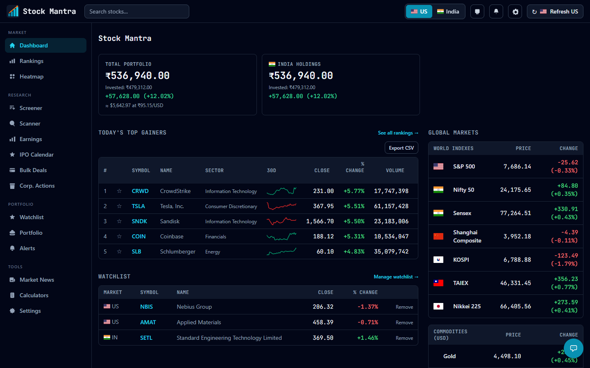
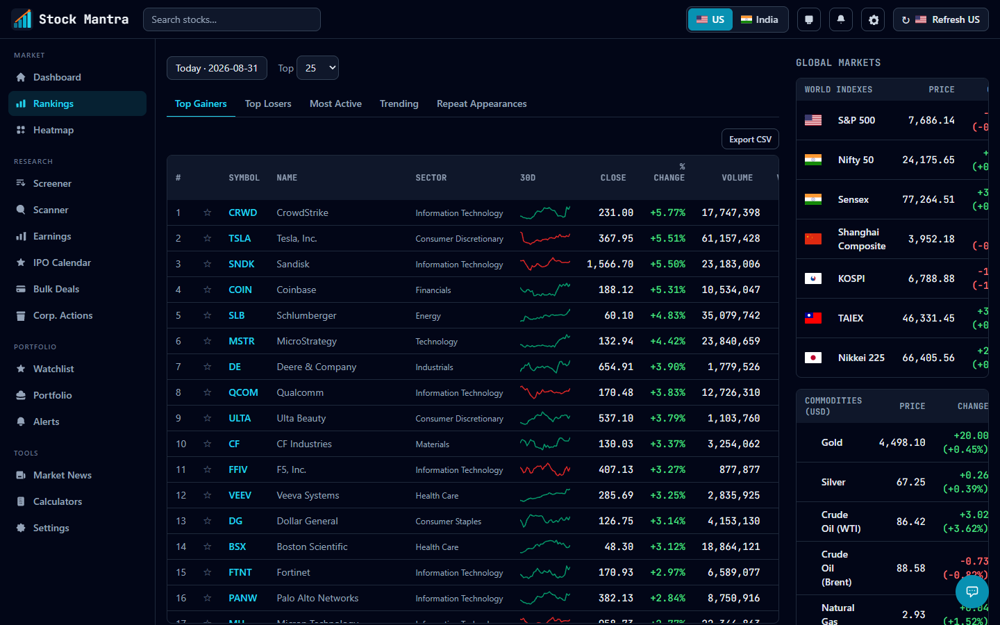
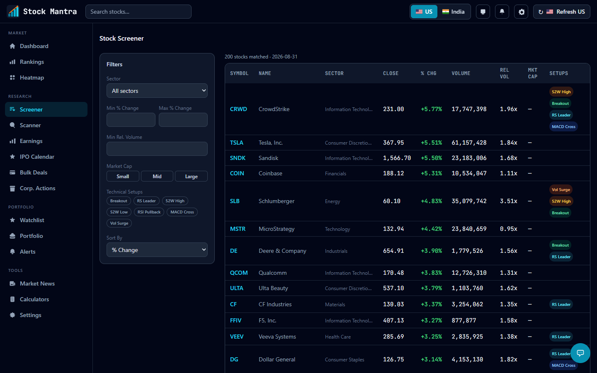

# Stock Mantra

Self-hosted stock market tracker for **US** (S&P 500 + Nasdaq-100, ~600 symbols) and **India** (all NSE equities, ~2,500 symbols). Runs entirely on your machine — no subscriptions, no cloud.

---

## Screenshots

### Dashboard


### Rankings


### Stock Screener


---

## Features

| Category | What's included |
|---|---|
| **Market Overview** | Live portfolio P&L, global indices & commodities, FII/DII flow widget |
| **Rankings** | Top Gainers · Top Losers · Most Active · Trending — with multi-day persistence tracking |
| **Stock Detail** | OHLCV candlestick chart, fundamentals, peer comparison, news sentiment, quarterly/annual financials |
| **Screener** | Filter by % change, relative volume, market cap, and technical setups (Breakout, RS Leader, 52W High, MACD Cross…) |
| **Scanner** | Pattern-based signal scanner across the full universe |
| **Watchlist & Portfolio** | Track holdings, cost basis, unrealised P&L, portfolio risk metrics |
| **Alerts** | Price-level alert rules with trigger history |
| **Earnings Calendar** | Upcoming and past earnings with beat/miss indicators |
| **IPO Calendar** | Upcoming listings for both US and India |
| **Corporate Actions** | Dividends, splits, buybacks |
| **Bulk Deals** | Block/bulk deal feed |
| **Market News** | Categorised news sentiment (geopolitical, regulatory, macro, competitive) |
| **ML Forecasts** | RandomForest next-day direction forecast, sector-relative return, calibrated probabilities |
| **Heatmap** | Sector-wise market heatmap |
| **Calculators** | Financial calculators |

---

## Stack

- **Backend:** FastAPI · SQLAlchemy · SQLite (WAL) · APScheduler
- **Frontend:** React 19 · React Router 7 · TanStack Query · Tailwind CSS · lightweight-charts
- **US data:** `yfinance` (batched, pinned to 1.5.1)
- **India data:** NSE Bhavcopy via `curl_cffi` (Akamai TLS bypass)
- **ML:** scikit-learn RandomForest on daily OHLCV + macro features

---

## Quick Start

### Docker (recommended)

```bash
docker compose up --build -d   # frontend :5173 · backend :8010
```

Tables are created automatically on first startup. Each market backfills itself on first run (visible in `docker compose logs -f backend`). Data persists across restarts in the `stocks_data` named volume; use `docker compose down -v` to wipe it.

### Bare dev

```bash
# Backend
cd backend
python -m venv venv
./venv/Scripts/pip install -r requirements.txt   # Windows; use venv/bin/pip on macOS/Linux
./venv/Scripts/python scripts/init_db.py
./venv/Scripts/python -m uvicorn app.main:app --host 127.0.0.1 --port 8001

# Frontend (separate terminal)
cd frontend
npm install
npm run dev   # http://localhost:5173
```

API docs available at `http://127.0.0.1:8001/docs`.

---

## Data Sources & Refresh Schedule

| Market | Source | Schedule |
|---|---|---|
| US equities | yfinance (Yahoo Finance) | Daily after NYSE close (5 PM ET) |
| India equities | NSE Bhavcopy CSV | Daily after NSE close (6 PM IST) |
| Fundamentals | yfinance + NSE | Weekly (Sunday 3:30–4 AM ET) |
| ML Forecasts | On-device RandomForest | Weekly retrain (Sunday 5 AM ET) |
| Macro / Sentiment | Various | Daily (7 PM ET) |

A 30-minute watchdog catches any missed refreshes automatically.

---

## Project Structure

```
backend/app/
  main.py          — FastAPI lifespan: table creation → migrations → scheduler start
  routers/         — API routes (stock, rankings, screener, scanner, ai, forecast, …)
  services/        — Business logic (refresh, backfill, forecasts, fundamentals, NSE, …)
  models.py        — SQLAlchemy ORM models

frontend/src/
  pages/           — 15 route pages (Dashboard, Rankings, Screener, Scanner, Earnings, …)
  components/      — Feature-scoped UI components
  api/client.ts    — Centralised fetch wrapper + all API methods
  context/         — MarketContext (US/IN toggle), ThemeContext
```

---

## Useful Scripts

```bash
# Manual backfill / catch-up
./venv/Scripts/python scripts/run_backfill.py --market US|IN|BOTH [--days N]

# Smoke tests for each market's fetch pipeline
./venv/Scripts/python scripts/fetch_us_once.py
./venv/Scripts/python scripts/fetch_india_bhavcopy_once.py

# Run backend tests
./venv/Scripts/python -m pytest
```
